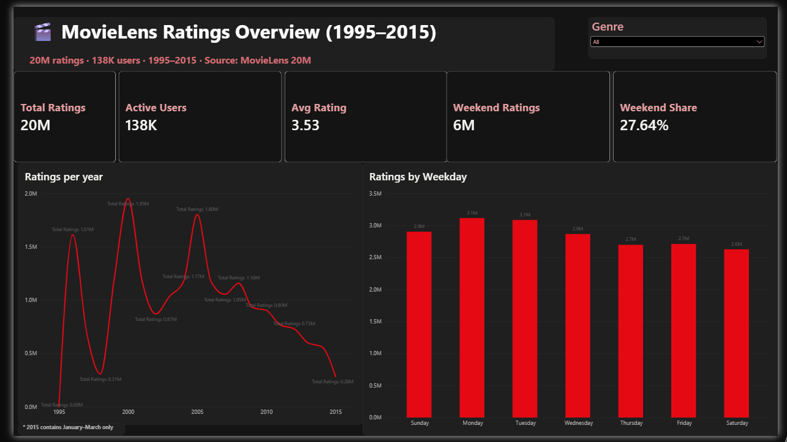
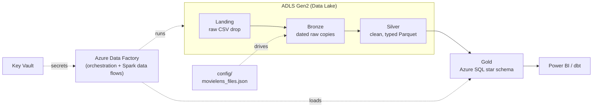
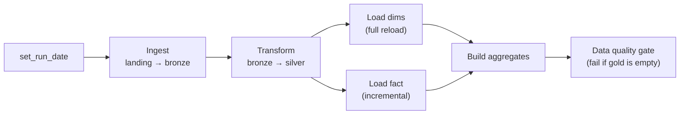
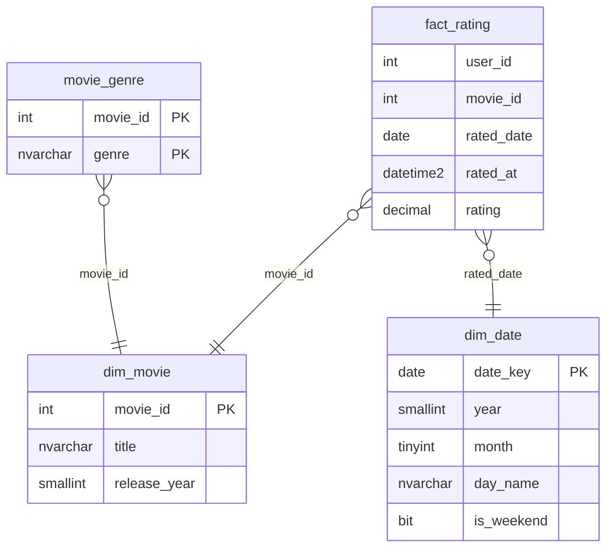
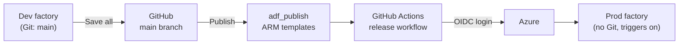
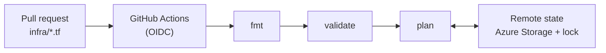

# 🎬 Netflix-Style Movie Analytics Pipeline on Azure

An end-to-end, production-style data engineering project that ingests, cleans, models and serves **20 million movie ratings** (MovieLens 20M) on Microsoft Azure.

Built with **Azure Data Factory**, **ADLS Gen2**, **Mapping Data Flows (Spark)** and **Azure SQL Database**, following the **medallion architecture** (bronze → silver → gold) and a **Kimball star schema**, with orchestration, incremental loading, data quality gates, alerting, zero-secret security, **CI/CD from dev to prod with GitHub Actions** and **infrastructure managed with Terraform**.

---

## 📌 Highlights

| | |
|---|---|
| **Volume** | 20,000,263 ratings · 27,278 movies · 6 source files |
| **Architecture** | Landing → Bronze → Silver (Parquet) → Gold (Azure SQL star schema) |
| **Orchestration** | One master pipeline, single run date passed to every stage, weekly schedule |
| **Incremental load** | Watermark pattern: first run loaded **283,886** new rows, re-run loaded **0** |
| **Performance** | 20M rows loaded into SQL in **5 min 19 s** (~60k rows/s); Parquet ~60% smaller than CSV |
| **Data quality** | Assert rules, file existence checks, row-count quality gate on gold |
| **Security** | **Zero stored secrets**: Managed Identity + RBAC + Azure Key Vault |
| **CI/CD** | Separate dev and prod factories; GitHub Actions release workflow with **OIDC** (no stored credentials), trigger stop/start and automatic cleanup |
| **Infrastructure as Code** | Existing Azure resources **imported into Terraform**; remote state with locking; `terraform plan` runs on every pull request |
| **Git workflow** | Feature branches, pull requests and merge to `main`; production is never edited by hand |

---

## 📊 Power BI dashboard



Import-mode model on the gold star schema (fact → movie and date dimensions, genre bridge with two-way filtering), DAX measures (`Total Ratings`, `Avg Rating`, `Active Users`, `Weekend Share` with `CALCULATE`), genre slicer and a Netflix-style theme. Read access uses a dedicated read-only SQL user.

**Insights:** ratings are spread almost evenly across the week (weekend share 27.6% vs 28.6% expected), with Monday and Tuesday slightly ahead of Saturday; Horror averages 3.28 vs 3.53 overall; 2015 contains January–March only, so its drop is a partial period, not a trend.

---

## 🏗️ Architecture



### Medallion layers

| Layer | Storage | Format | Purpose |
|---|---|---|---|
| **Landing** | `landing/movielens/` | CSV | Drop zone for source files, untouched |
| **Bronze** | `bronze/movielens/<table>/ingest_date=YYYY-MM-DD/` | CSV | Immutable, date-partitioned history of every load |
| **Silver** | `silver/movielens/<table>/` | Parquet (snappy) | Cleaned, typed, validated data |
| **Gold** | Azure SQL `gold` schema | Tables | Business-ready star schema + aggregates |

---

## 🔄 Orchestration

A single master pipeline runs the whole flow. It computes **one run date** and passes it to every child pipeline as a parameter, so all layers process the same batch.



| Pipeline | Role |
|---|---|
| `pl_master_movielens` | Orchestrates everything with Execute Pipeline activities and success dependencies |
| `pl_ingest_movielens_dynamic` | Metadata-driven ingestion (Lookup + ForEach + Copy) with file validation |
| `pl_transform_movies_silver` | Runs the two silver data flows in parallel |
| `pl_load_gold_dims` | Full reload of small dimensions (`TRUNCATE` + insert) |
| `pl_incremental_fact_rating` | Watermark-based incremental load of the 20M-row fact table |
| `pl_build_gold_aggregates` | Builds pre-computed aggregate tables with Join + Aggregate |

**Triggers:** weekly schedule trigger (Sunday 03:00, Casablanca time) that runs **only in the production factory**; the dev factory is used for debug runs. A storage-event pattern with a `_READY` marker file was also designed to avoid one run per file.

---

## ⭐ Gold star schema

Designed with Kimball's four steps: **business process** (a user rates a movie) → **grain** (one row per user-movie rating) → **dimensions** (movie, date) → **facts** (rating).



| Table | Type | Rows | Notes |
|---|---|---|---|
| `fact_rating` | Fact | 20,000,263 | Clustered **columnstore** index for fast aggregation |
| `dim_movie` | Dimension | 27,278 | Title cleaned, release year extracted with regex |
| `dim_date` | Dimension | 8,036 | Generated calendar 1995–2016 (recursive CTE) |
| `movie_genre` | Bridge | ~54k | Multi-valued genres normalized to avoid double counting |
| `agg_movie_stats` | Aggregate | 26,744 | Ratings count, average, first/last rating date per movie |
| `agg_genre_year` | Aggregate | 387 | Ratings count and average per genre and year |
| `etl_watermark` | Control | 1 | Bookmark for the incremental load |

`user_id` is kept as a degenerate dimension because the source provides no user attributes.

---

## 🛠️ Key engineering features

### 1. Metadata-driven ingestion
A JSON control file lists the source files. A **Lookup** reads it, a parallel **ForEach** iterates over it, and one parameterized **Copy** activity lands each file in a date-partitioned bronze folder. Adding a new table means adding one line to the config, with no pipeline change.

### 2. Validation and failure handling
**Get Metadata** checks each file exists before copying. Missing files are collected with **Append Variable** (safe in a parallel ForEach, unlike Set Variable), available files are still loaded, and the pipeline ends with a **Fail** activity and a clear custom error code (`MISSING_SOURCE_FILES`).

### 3. Transformations on Spark (Mapping Data Flows)
- Explicit **Cast** of all types (raw columns read as strings to avoid inference bugs)
- **Regex** to split `"Toy Story (1995)"` into title and release year
- Unix timestamps converted to real dates, plus date, weekday and year columns
- **Flatten** of pipe-separated genres into a bridge table
- **Assert** rules: rating between 0.5 and 5.0, non-null keys
- Output as **Parquet**, overwriting the target folder for idempotent reruns

### 4. Idempotency
Every load can be re-run safely: lake writes clear the target folder, SQL loads use `TRUNCATE` or the watermark, and duplicates are blocked by primary keys.

### 5. Incremental load (watermark pattern)
1. **Lookup** reads the last loaded timestamp from `etl_watermark`
2. A **data flow** filters silver to `rated_at > watermark` and appends to the fact table
3. A **Script** activity moves the watermark forward, only after a successful load

Verified with fault-free reruns: first run **283,886** rows, second run **0** rows, total unchanged at 20,000,263.

### 6. Data quality gate
After the aggregates, a Lookup counts rows in `gold.agg_movie_stats`. If it is below a threshold, the pipeline **fails loudly** (`DQ_AGG_EMPTY`) instead of reporting a green run with empty tables.

### 7. Monitoring and alerting
Azure Monitor metric alert on failed pipeline runs with an email action group, tested by **fault injection** (a deliberately missing source file).

### 8. Security: zero secrets
- ADF → ADLS Gen2: **system-assigned managed identity** with `Storage Blob Data Contributor`
- ADF → Azure SQL: managed identity mapped to a contained database user with `db_datareader`, `db_datawriter`, `db_ddladmin` (least privilege, no `db_owner`)
- External secrets (API keys) in **Azure Key Vault** with RBAC: `Secrets Officer` for the admin, `Secrets User` (read-only) for ADF
- GitHub Actions → Azure: **OIDC federated credential** bound to this repository's `main` branch (immutable owner and repository IDs), with `Data Factory Contributor` only
- Power BI → Azure SQL: dedicated **read-only** database user (`db_datareader`), separate from the pipeline identity

---

## 🚀 CI/CD: dev → prod

Development happens in a **Git-integrated dev factory**. Production is a **separate factory with no Git connection** that is only changed by the release workflow.



**Development flow:** create a feature branch in ADF Studio → change and debug → open a **pull request** → review → merge to `main` → **Publish** (only allowed from `main`), which generates ARM templates in `adf_publish`.

**Release workflow** ([`.github/workflows/deploy-adf-prod.yml`](.github/workflows/deploy-adf-prod.yml)), started manually:

| Step | What it does | Why |
|---|---|---|
| 1. Checkout `adf_publish` | Gets the ARM template of the whole factory | The template is the single source for the release |
| 2. Login (OIDC) | Federated credential, short-lived token | No client secret stored anywhere |
| 3. Stop prod triggers | Stops running schedules | A pipeline must not start mid-deployment |
| 4. Deploy ARM template | Deploys with `factoryName=alaaNetflixDF-prod` override | Same definition, different environment |
| 5. Remove objects deleted in dev | Deletes prod pipelines, data flows and datasets missing from the template | Incremental ARM deployments never delete; a **safety guard** skips deletion if the template can't be read |
| 6. Start prod triggers | Restarts schedules | Production resumes automatically |

> For cost reasons, prod shares the storage account and database with dev. In a real setup each environment has its own resource group and resources, injected through ARM parameter overrides.

---

## 🏗️ Infrastructure as Code: Terraform

The platform was first built in the Azure portal, then **brought under Terraform without recreating anything**: each resource was imported with `import` blocks, and the configuration was written to match what was already deployed (`terraform plan` → *No changes*).

| Managed by Terraform | Notes |
|---|---|
| Resource group | Standardized tags (`environment`, `owner`, `project`, `managed_by`) |
| ADLS Gen2 storage account | `prevent_destroy`, no public blob access, TLS 1.2 |
| 5 medallion containers | One `for_each` resource over `landing`, `bronze`, `silver`, `gold`, `config` |
| Key Vault | RBAC authorization, `prevent_destroy` |
| Dev and prod Data Factories | System-assigned identities; dev keeps its GitHub integration |



- **Remote state** in a dedicated storage account (`tfstate` container) with blob-lease locking, Entra ID authentication and versioning. It is kept outside the resources Terraform manages to avoid the state deleting itself.
- **CI on every PR** ([`.github/workflows/terraform-plan.yml`](.github/workflows/terraform-plan.yml)): `fmt -check`, `validate` and `plan`, authenticated through an OIDC credential scoped to pull requests, with read-only roles (`Reader`, `Reader and Data Access`) plus blob access on the state account for locking.
- **Apply stays manual** after review, from a saved plan (`plan -out` → `apply tfplan`) so exactly the reviewed changes are applied.
- State files, plans and `tfvars` are excluded from Git.

**What the import revealed** (invisible in the portal): misspelled tag keys with trailing spaces (`"Enviroment "`), a resource group in West Europe while the data lives in Central US, and the dev factory in East US, which is why its data flows ran on an East US integration runtime. Tags were fixed through Terraform; locations were left as-is because changing them forces resource replacement.

---

## 🐛 Lessons learned (real bugs found and fixed)

| Problem | Symptom | Root cause | Fix |
|---|---|---|---|
| **Silent failure** | Aggregates pipeline "Succeeded" but gold tables had **0 rows** | Silver columns were renamed; stale data flow projections + schema drift read the old names as `NULL`, so the inner join matched nothing | Traced with **column lineage**, re-imported projections, added a **row-count quality gate** |
| **Duplicated data** | 60,000,789 rows read instead of 20,000,263 | Sink missing "clear the folder", so each rerun **added** files | Enabled folder clearing; learned to read Spark part-file run IDs |
| **Primary key violation** | `Cannot insert duplicate key (1, Adventure)` | Same duplicated-files issue on the genres table | PK caught it before bad data reached gold |
| **Type inference trap** | IDs above 32,767 would overflow | Projection inferred `short` from a 1,000-row sample | Read raw as string, cast explicitly to `integer` |
| **Wrong path** | `does not resolve to any file(s)` | Typo `btonze` in a container parameter | Read the full path in the error; plan global parameters |
| **Expression bugs** | `BadRequest` with no message | `@@` (escaped `@`) and leading spaces turning expressions into literal text | Always check the first character of dynamic content |
| **Fan-out in joins** | Inflated counts when joining genres | One rating × N genres | Aggregate before joining, `EXISTS` semi-joins, allocation |
| **Cloud constraints** | Region and free-tier provisioning errors | Student subscription region policy | Picked a supported region; same region for storage and SQL |
| **Alert never fired** | Pipeline failed, no alert | Metric alert dimensions "select all" only captured the values that existed at creation (no failures yet) | Removed dimension filters: one series covering every pipeline, also cheaper |
| **Objects lingering in prod** | Pipeline deleted in dev still present in prod after release | ARM deployments are incremental by default and never delete | Added a cleanup step comparing prod with the template, with a safety guard |
| **Fix not deployed** | Corrected workflow still ran the old steps | "Re-run" replays the original commit's workflow file | Start a new run so the latest `main` version is used |
| **Generated Terraform rejected** | Imported config failed validation (`$account-encryption-key`, retention `0`) | Config generation copies Azure's internal defaults, which the provider doesn't accept as input | Wrote clean configuration by hand and confirmed it with *No changes* |
| **OIDC login refused in CI** | `AADSTS700213: No matching federated identity record` | Owner and repository IDs swapped in the pull-request credential (new repos use immutable ID-based subjects) | Compared the subject in the error with the credential and recreated it from JSON |
| **Impossible Power BI value** | Hamlet showed an average rating of 27 on a 5-star scale | Several films share the same cleaned title; the visual grouped by title and summed averages | Disabled summarization and grouped by the movie key; added sanity checks |

---

## 📊 Example analytical queries

```sql
-- Top 10 movies with at least 10,000 ratings
SELECT TOP 10 m.title, COUNT(*) AS ratings, CAST(AVG(f.rating) AS DECIMAL(3,2)) AS avg_rating
FROM gold.fact_rating f
JOIN gold.dim_movie m ON m.movie_id = f.movie_id
GROUP BY m.movie_id, m.title
HAVING COUNT(*) >= 10000
ORDER BY avg_rating DESC;

-- Do people rate differently on weekends?
SELECT CASE WHEN d.is_weekend = 1 THEN 'Weekend' ELSE 'Weekday' END AS day_type,
       COUNT(*) AS ratings, AVG(f.rating) AS avg_rating
FROM gold.fact_rating f
JOIN gold.dim_date d ON d.date_key = f.rated_date
GROUP BY CASE WHEN d.is_weekend = 1 THEN 'Weekend' ELSE 'Weekday' END;

-- Best movie per genre (window function)
WITH ranked AS (
    SELECT g.genre, m.title, AVG(f.rating) AS avg_rating,
           ROW_NUMBER() OVER (PARTITION BY g.genre ORDER BY AVG(f.rating) DESC) AS rn
    FROM gold.fact_rating f
    JOIN gold.dim_movie   m ON m.movie_id = f.movie_id
    JOIN gold.movie_genre g ON g.movie_id = f.movie_id
    GROUP BY g.genre, m.title
    HAVING COUNT(*) >= 1000
)
SELECT genre, title, CAST(avg_rating AS DECIMAL(3,2)) AS avg_rating
FROM ranked WHERE rn = 1 ORDER BY genre;
```

---

## 🧰 Tech stack

**Azure Data Factory** (pipelines, Mapping Data Flows, triggers, Git integration) · **ADLS Gen2** · **Azure SQL Database** (serverless, columnstore) · **Azure Key Vault** · **Azure Monitor** · **Microsoft Entra ID** (managed identities, RBAC, OIDC federation) · **Terraform** (azurerm, import, remote state) · **ARM templates** · **GitHub Actions** · **Power BI** (DAX) · **SQL** (T-SQL, window functions, CTEs) · **Git / GitHub**

---

## 📁 Repository structure

```
├── .github/workflows/
│   ├── deploy-adf-prod.yml   # release workflow: dev → prod
│   └── terraform-plan.yml    # fmt, validate and plan on infra pull requests
├── adf/                    # ADF resources, auto-synced by Git integration
├── infra/                  # Terraform: storage, containers, Key Vault, factories, backend
│   ├── pipeline/
│   ├── dataflow/
│   ├── dataset/
│   ├── linkedService/
│   └── trigger/
├── config/
│   └── movielens_files.json  # metadata driving the ingestion
├── sql/
│   └── gold_schema.sql       # gold star schema DDL + dim_date generation
└── README.md
```

---

## 🚀 How to reproduce

1. Download **MovieLens 20M** and upload the CSVs to `landing/movielens/` in an ADLS Gen2 account (hierarchical namespace enabled), with containers `landing`, `bronze`, `silver`, `config`.
2. Upload `config/movielens_files.json` to the `config` container.
3. Create an Azure SQL Database and run `sql/gold_schema.sql`.
4. Create a Data Factory, connect it to this repository (Git configuration, root folder `/adf/`).
5. Grant the factory's managed identity `Storage Blob Data Contributor` on the storage account and create its database user (see Security section).
6. Publish and run `pl_master_movielens`.

---

## 🗺️ Roadmap

- [x] CI/CD: dev → prod deployment with GitHub Actions, OIDC and ARM templates
- [x] Infrastructure as Code with **Terraform** (import, remote state, plan on PRs)
- [x] Power BI overview dashboard on the gold star schema (model, DAX measures, Netflix-style theme)
- [ ] Bring Azure SQL and role assignments under Terraform
- [ ] Separate prod resources (storage, SQL, Key Vault) in their own resource group
- [ ] Terraform apply from CI with an approval gate
- [ ] dbt models and tests on top of gold
- [ ] Ingest movie metadata from the **TMDB REST API** (secrets in Key Vault)
- [ ] Migration to **Microsoft Fabric** (Lakehouse + notebooks)

---

## 👤 Author

**Alae Eddine El Jirari**, Consultant Engineer · MSc AI, Big Data & Cloud Computing (ENSET Mohammedia)

[LinkedIn](https://www.linkedin.com/in/alaeddineeljirari/) · [GitHub](https://github.com/Aeljirai)

*Dataset: F. Maxwell Harper and Joseph A. Konstan. 2015. The MovieLens Datasets: History and Context. ACM TiiS. Data from GroupLens Research.*
